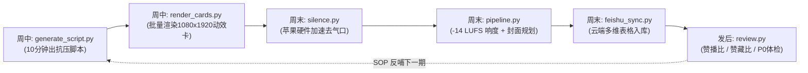

# Creator Studio · 个人自媒体全链路作战工作流

<p align="center">
  <strong>专为硬核技术人打造的个人自媒体自动化流水线</strong><br>
  从选题生成、动效卡片渲染、音频标准化到发后数据体检的全流程工业化解决方案
</p>

<p align="center">
  
  
  
  
</p>

---

## 💡 为什么做这个项目？

做自媒体最容易踩两个极端的大坑：
1. **陷入臃肿繁琐的自建泥潭**：自己写数据库、爬虫服务和后台管理，还没发两条视频就把时间耗尽在系统维护上；
2. **陷入低质套壳的商业陷阱**：使用第三方商业套壳软件（美图/开拍/剪映模板），生产出雷同且充满“AI塑料感”的假人假稿，随时面临平台限流。

**Creator Studio 的核心哲学**：
- **拒绝玩具 Demo，死磕真实生产力**：以真实翻车实测作为护城河，击穿 AI 虚假营销。
- **飞书为云端总脑，本地为执行中枢**：所有工程状态直接沉淀在飞书多维表格，本地敲一行命令自动咬合。
- **严格适配技术人作息**：**周中 2 晚各 1 小时备料打磨，周末 3.5 小时集中出片，周一发后 15 分钟数据反哺**。

---

## 🛠 工具箱全景 (Toolchain Overview)



| 脚本文件 | 核心职责 | 耗时与机制 |
| :--- | :--- | :--- |
| [`scripts/scout_topics.py`](./scripts/scout_topics.py) | **选题雷达与85分团队打分引擎**：自动扫描 GitHub AI Trending、Hacker News、Hugging Face 情报，运行 5 维打分模型，>= 85 分准入立项并可选直通出片 | ~3 秒 |
| [`scripts/generate_script.py`](./scripts/generate_script.py) | **10分钟爆款脚本生成引擎**：支持三大赛道（硬核测评 / 省时间 / 加速老赛道），自动生成黄金3秒狠话、短句重音标点、画中画运镜指令及小红书/B站/抖音多平台发布文案 | ~5 秒 |
| [`scripts/render_cards.py`](./scripts/render_cards.py) | **高清动效卡片渲染引擎**：基于 Playwright 批量渲染 1080x1920 竖版红绿勾叉表、数字胶囊卡与代码高亮框 | ~30 秒 |
| [`scripts/cut_silence.py`](./scripts/cut_silence.py) | **智能切除口播气口**：利用苹果 VideoToolbox 硬件加速，自动切除 0.6s 以上停顿气口，大幅提升前 5 秒留存 | ~10 秒 |
| [`scripts/pipeline.py`](./scripts/pipeline.py) | **全自动流水线总控**：一键串联音频 `-14 LUFS` 广播级响度标准化、封面方案 8 候选帧截取与飞书多维表格入库 | ~20 秒 |
| [`scripts/review.py`](./scripts/review.py) | **数据体检与归因复盘引擎**：量化计算赞播比、赞藏比、转粉率，判定“中长横屏 90 天长效推荐池”，自动输出 🔴 P0 / 🟠 P1 / 🟡 P2 复盘报告 | ~3 秒 |
| [`scripts/feishu_sync.py`](./scripts/feishu_sync.py) | **飞书多维表格云端同步器**：本地工程目录与飞书云端双向打通，随时随地手机查阅进度 | ~2 秒 |
| [`dashboard/index.html`](./dashboard/index.html) | **自媒体闭环运营作战大屏**：清爽亮色系交互看板，内置实时计算器与终端命令备忘 | 双击即开 |

---

## 🚀 快速上手 (Quick Start)

### 1. 环境准备
需要 Python 3.10+ 与 FFmpeg（支持硬件加速）：
```bash
git clone https://github.com/MZFL-BH/creator-studio.git
cd creator-studio
pip install -r requirements.txt
playwright install chromium
```

### 2. 标准出片三步法

#### 第一步：周中初始化选题工程与脚本
```bash
python3 scripts/generate_script.py "公司PPT母版丢给4个AI" -t benchmark -c "低粉爆款对标" -o ./20261030-template-ppt
```
> 输出包含：
> - `script.md`：黄金3秒开门狠话 + 短句带重音 + 嘴角带笑录音指引 + 画中画全屏指示；
> - `publish.md`：小红书大字报文案、B站深度横评简介、抖音/视频号横屏文案。

#### 第二步：周末录制与一键流水线总装
录完出镜和录屏后，丢入工程目录并执行总控流水线：
```bash
python3 scripts/pipeline.py ./20261030-template-ppt
```
- 自动完成 `-14 LUFS` 广播级音频对齐；
- 自动生成 8 候选帧封面建议；
- 自动入库飞书多维表格。

#### 第三步：发后 48 小时数据体检复盘
```bash
python3 scripts/review.py ./20261030-template-ppt --views 3500 --likes 180 --saves 120 --bounce2s 28.5 --retention5s 36.0
```
- 自动输出 `review.md`，深度穿透是否存在前 2 秒跳出过高、中段完播塌方或赞藏比偏低问题，直接反哺下周周中写稿。

---

## 📖 核心方法论与参考指南 (References)

项目内置了 6 年自媒体一线实操经验与算法演进总结：
- [01 选题与对标侦察指南](./references/01_topic_research.md)：Mini博主对标法、评论区挖宝三步法；
- [02 脚本与分镜抗压指南](./references/02_script_storyboard.md)：黄金3秒五大范式、标准四列分镜表；
- [03 剪辑与字幕优化指南](./references/03_editing_workflow.md)：响度压制、画中画叠加、Whisper打轴；
- [04 发布分发与数据复盘指南](./references/04_distribution_analytics.md)：小红书/B站/抖音平台差异化文案、指标健康度阈值；
- [05 六年自媒体老兵核心实战铁律](./references/05_veteran_rules.md)：三大黄金选题支柱、口播五大铁律、网感剪辑双杠杆、破除完美主义心法。

---

## 🤖 Antigravity / Agent Skill 交互集成

本项目原生支持作为 **Antigravity / Cursor / Claude Skill** 运行：
- 配置文件：`SKILL.md`
- 交互式门禁：呼叫时自动弹出可视化下拉单选菜单（`ask_question`），一键选择具体执行动作，AI 自动在后台调起对应脚本并汇报执行结果。

---

## 📄 开源许可证

本项目采用 [MIT License](./LICENSE) 协议开源。欢迎 Fork、Star 和贡献代码！

**Author**: Ethan Wang ([@MZFL-BH](https://github.com/MZFL-BH))
